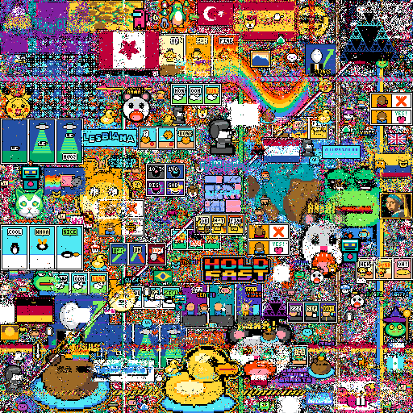

# place-sim

A local AI/ML simulation of Reddit's **[r/place](https://www.reddit.com/r/place/)** built for Apple Silicon (PyTorch MPS, Apple MLX, local `Qwen3-VL-30B-A3B` via LM Studio or Ollama, MLX `FLUX.1-schnell` + Pixel-Art LoRA, live web dashboard, and direct `ffmpeg` 60fps 2K timelapse export).

No cloud APIs are used. Every citizen placement, emergent faction concept, pixel-art blueprint, sandboxed geometric script, and diplomatic decision runs locally.

<p align="center">
  
  <br />
  <em>6-hour local run compressed to 20 seconds: 88.2M pixel placements, 4.0M simulated users (~20% one-shot), and 200 concurrent factions.</em>
</p>

## How It Works

1. **1:1 Reddit r/place 2022 Scale & 4-Act Canvas Expansion (`canvas.py`, `palette.py`, `engine.py`)**
   - Supports three scale presets (`standard` 512x512, `large` 1024x1024, and `reddit2022` 2000x2000).
   - **Act 1:** Starts at half-scale (`1000x1000`) with the original 16 colors.
   - **Act 2:** Doubles East (`2000x1000`), unlocks 24 colors, and triggers an Eastern land rush.
   - **Act 3:** Doubles South (`2000x2000`), unlocks all 32 colors, and triggers a Southern land rush.
   - **Act 4 (Whiteout Finale):** Preserves `final_peak_2k.png`, locks the palette to pure white (`#FFFFFF`), and sweeps the canvas blank.

2. **GPU Citizen Policy (`src/pixel_battle/policies/`, `src/pixel_battle/ml/`)**
   - Simulates up to 120,000 concurrent online citizen slots on PyTorch MPS behind a swappable `PixelPolicy` interface (`NeuralRedditPolicy` or `StochasticPolicy`).
   - `RedditCitizenNet` (`models/reddit_citizen.pt`) is trained via behavioral cloning on official Reddit r/place 2022 placement logs, predicting local click location and unlocked-palette color choices from 21x21 canvas patches.
   - Citizen slots cycle through unique 32-bit `user_id`s averaging ~15.5 pixels/user (~20% one-shot citizens placing a single pixel), reaching ~10M unique users and ~2M one-shot participants across ~160M placements.

3. **AI-First Emergent Factions, Fluid Borders & Living Culture (`brain.py`, `art/flux_art.py`, `art/manager.py`)**
   - Local **`qwen3-vl-30b-a3b-instruct-mlx`** (OpenAI-compatible LM Studio API with macOS Keychain Bearer auth) invents non-repeating global communities across Chinese, Spanish, French, German, Japanese, Korean, Portuguese, Turkish, and English, plus pop-culture fandoms, 3-panel pixel comic strips, and visionless geometric chaos patterns.
   - Local **4-bit MLX `FLUX.1-schnell` + `pixelart_schnell_v1.safetensors` Pixel-Art LoRA** renders crisp pixel art quantized strictly into the active palette tier, using fluid non-rectangular die-cut silhouettes by default (rectangles reserved for comic strips, flags, and framed paintings).
   - Sandboxed AST-validated Python execution lets the LLM author pure geometric pixel patterns (`ai_code`), alongside restrained accurate national flags (<= 1 active copy per country, locked to true regional timezones), progressive transverse ribbons, subtle tiny hidden crewmate cameos, and a 4-variant Void cycle.
   - **72-hour virtual clock:** Regional timezone sleep/wake waves (`EUROPE`, `AMERICAS`, `LATAM`, `ASIA_PACIFIC`, `GLOBAL`), prime-time streamer flash-raids, community burnout, and expiring/capped alliances keep territory evolving continuously.

4. **Binary Event Log, Live Dashboard & Dynamic-Camera 2K Timelapses (`events.py`, `server.py`, `timelapse.py`)**
   - Records every placement in a compact 16-byte binary log (`events.bin`, v2 with `uint32 user_id` and `uint16 faction`, read-compatible with v1 12-byte logs) plus `chronicle.jsonl`.
   - Streams memory-mapped replays directly into `ffmpeg` with smooth 4-Act dynamic camera pull-back (`1000x1000 -> 2000x1000 -> 2000x2000 -> Whiteout`).

## Requirements

- macOS on Apple Silicon (PyTorch MPS + Apple MLX)
- Python 3.12+ and [uv](https://docs.astral.sh/uv/)
- `ffmpeg` on `PATH` (for MP4 timelapse rendering)
- [LM Studio](https://lmstudio.ai/) running locally (`http://localhost:1234/v1`) with `qwen3-vl-30b-a3b-instruct-mlx` loaded (recommended `--context-length 4096`).
  - If API authentication is enabled in LM Studio, store your least-privilege Bearer token safely in macOS Keychain (never in repo files):
    ```bash
    security add-generic-password -U -a "$USER" -s place-sim -w
    ```
  - Alternatively, pass `LMSTUDIO_API_KEY` in the environment or point `--llm-url` at a local Ollama instance.
- Local Hugging Face caches for `dhairyashil/FLUX.1-schnell-mflux-4bit` and `hliu143/dr-diffusion-flux-1-s-pixel-art-lora` (`pixelart_schnell_v1.safetensors`) are downloaded automatically on first run.

## Quickstart

```bash
# Install dependencies
uv sync --python 3.12

# Verify local PyTorch MPS, LM Studio Qwen3-VL, and MLX FLUX Pixel-Art LoRA
uv run pixel-battle test-stack

# Start a live simulation with the web viewer at http://127.0.0.1:8765
uv run pixel-battle run --preset standard

# Run an unattended 8-hour 1:1 Reddit r/place 2022 simulation and auto-render 2K timelapses
bash scripts/run_reddit_2022.sh runs/reddit_2022_8h 8.0

# Render a 60fps 2K dynamic-camera timelapse MP4 from any run directory (works while live)
uv run pixel-battle render runs/reddit_2022_8h \
  --out runs/reddit_2022_8h/timelapse_2k.mp4 \
  --fps 60 --duration 90 --scale 1 --hold 4 --curve 1.35

# Run the test suite
uv run --with pytest pytest -v tests/test_core.py
```

## Optional Data & Retraining

- **Pre-trained citizen policy:** `models/reddit_citizen.pt` is included so simulations work out of the box. To re-download official r/place 2022 chunks and retrain from scratch on MPS:
  ```bash
  uv run pixel-battle train-reddit
  ```
- **Subreddit community directory:** If `data/subreddits/retained_active_subreddits.csv` (from the public [ssingh22/reddit-activity](https://huggingface.co/datasets/ssingh22/reddit-activity) dataset) is present, community inspiration samples real active non-NSFW subreddits by rank; otherwise `subreddits.py` falls back to its built-in list.

## Visual Evolution & Docs

- **[Visual Progression Gallery](gallery/README.md):** Side-by-side snapshots, progression strips, and engineering post-mortems across all 8 simulation runs (from the original `512x512` baseline to the `360x640` vertical YouTube Short pipeline).
- **[Run Profiles](RUN_PROFILES.md):** Creative presets (`ytshort`, `reddit2022`, `standard`).
- **[Lessons Learned](LESSONS_LEARNED.md):** Apple Silicon MLX/MPS memory tuning, Art Bank decoupling, and visual bug post-mortems.
- **[Requirements](REQUIREMENTS.md):** System specification maintained under ASD-STE100 (Simplified Technical English).
- Released under the [MIT License](LICENSE).
