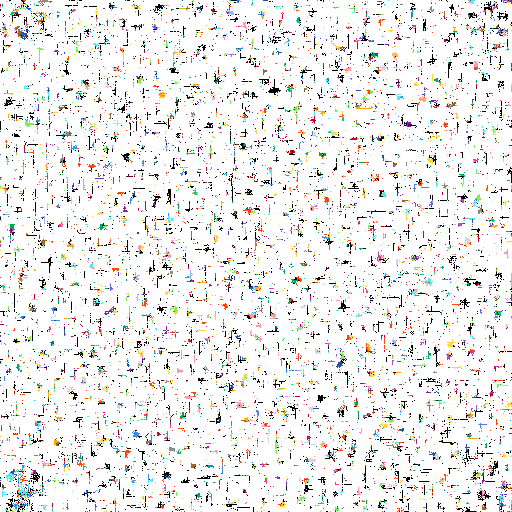

# place-sim

A local AI/ML simulation of Reddit's **[r/place](https://www.reddit.com/r/place/)** built for Apple Silicon (PyTorch MPS, Apple MLX, Ollama vision/text models, local pixel-art diffusion, live web dashboard, and direct `ffmpeg` 60fps timelapse export).

No cloud APIs are used. Every citizen placement, artwork blueprint, wordmark, and diplomatic decision runs locally.

<p align="center">
  
  <br />
  <em>6-hour local run compressed to 20 seconds: 88.2M pixel placements, 4.0M simulated users (~20% one-shot), and 200 concurrent factions on a 512x512 canvas.</em>
</p>

## How It Works

1. **GPU Citizen Policy (`src/pixel_battle/policies/`, `src/pixel_battle/ml/`)**
   - Simulates 36,000 concurrent online citizen slots on PyTorch MPS behind a swappable `PixelPolicy` interface (`NeuralRedditPolicy` or `StochasticPolicy`).
   - `RedditCitizenNet` (`models/reddit_citizen.pt`) is trained via behavioral cloning on official Reddit r/place 2022 placement logs, predicting local click location and 32-color palette choice from 21x21 canvas patches.
   - Citizen slots cycle through unique 32-bit `user_id`s with session click budgets calibrated to r/place demographics (~20% one-shot citizens placing a single pixel, plus casual, regular, and veteran sessions).
   - Ready builders and defenders across all active factions run in a single combined GPU forward pass per tick.

2. **Multi-Scale Ecosystem & VLM Diplomacy (`src/pixel_battle/brain.py`, `engine.py`, `detector.py`)**
   - Supports up to 200 simultaneous factions on a 512x512 canvas with power-law size tiers calibrated to public `placeAtlas` data (~60% Micro, ~24% Medium, ~12% Macro, ~4% Transverse Ribbons).
   - Local `qwen2.5vl:7b` (via Ollama) inspects upscaled canvas crops for emergent *pareidolia* discovery, then leads major factions through `BUILD`, `EXPAND`, `MORPH_ART`, `FORTIFY`, `RAID`, `PROPOSE_ALLIANCE`, `ACCEPT_ALLIANCE`, and `EXODUS`.
   - Includes allied border hearts, flag rivalries and treaties, cameo micro-sprites on wide flags/ribbons, progressive transverse ribbons, and a 4-variant Void cycle (tendrils, black holes, fractals, and void monsters).

3. **Hybrid Art & Typography (`src/pixel_battle/art/`)**
   - Combines local **SDXL-Turbo + `nerijs/pixel-art-xl`** img2img morphing with procedural generators: 32 national flags, 34 micro sprites, 12 multi-panel comic strips, 14 cartoon/meme portraits, gold-framed fine-art paintings, empty-space whiteout factions, transverse ribbons, and organic cutouts.
   - Three local typography engines: a multi-font 1-bit pixel studio, 4-bit MLX `FLUX.1-schnell` wordmarks gated by `qwen2.5vl:7b` edit-distance OCR, and sandboxed PIL flourishes generated by `qwen2.5:7b-instruct`.

4. **Binary Event Log, Live Dashboard & 2K Timelapses (`events.py`, `server.py`, `timelapse.py`)**
   - Records every placement in a compact 16-byte binary log (`events.bin`, v2 with `uint32 user_id` and `uint16 faction`, read-compatible with v1 12-byte logs) plus `chronicle.jsonl`.
   - Serves a live web viewer at `http://127.0.0.1:8765` and streams memory-mapped replays directly into `ffmpeg` for crisp nearest-neighbor 60fps 2K MP4 timelapses.

## Requirements

- macOS on Apple Silicon (PyTorch MPS + Apple MLX)
- Python 3.12+ and [uv](https://docs.astral.sh/uv/)
- `ffmpeg` on `PATH` (for MP4 timelapse rendering)
- [Ollama](https://ollama.com/) running locally with:
  ```bash
  ollama pull qwen2.5vl:7b
  ollama pull qwen2.5:7b-instruct
  ```
- Local Hugging Face model caches are downloaded on first run for `stabilityai/sdxl-turbo`, `nerijs/pixel-art-xl`, and (for Engine 2 wordmarks) 4-bit `FLUX.1-schnell` via `mflux`.

## Quickstart

```bash
# Install dependencies
uv sync --python 3.12

# Verify local PyTorch MPS, Ollama, and art generators
uv run pixel-battle test-stack

# Start a live 512x512 simulation with the web viewer at http://127.0.0.1:8765
# Uses models/reddit_citizen.pt automatically; pass --policy stochastic to compare
uv run pixel-battle run

# Run an unattended headless simulation (6 hours) and auto-render 2K timelapses
bash scripts/run_overnight_8h.sh runs/battle_01 6.0

# Render a 60fps 2K timelapse MP4 from any run directory (works while a run is live)
uv run pixel-battle render runs/battle_01 \
  --out runs/battle_01/timelapse_2k.mp4 \
  --fps 60 --duration 60 --scale 4 --hold 3 --curve 1.40

# Run the test suite
uv run --with pytest pytest -v tests/test_core.py
```

## Optional Data & Retraining

- **Pre-trained citizen policy:** `models/reddit_citizen.pt` is included so simulations work out of the box. To re-download official r/place 2022 chunks and retrain from scratch on MPS:
  ```bash
  uv run pixel-battle train-reddit
  ```
- **Subreddit community directory:** If `data/subreddits/retained_active_subreddits.csv` (from the public [ssingh22/reddit-activity](https://huggingface.co/datasets/ssingh22/reddit-activity) dataset) is present, faction naming samples real active non-NSFW subreddits by rank; otherwise `subreddits.py` falls back to its built-in community list.

## Specification & License

- System requirements are maintained in [REQUIREMENTS.md](REQUIREMENTS.md) following ASD-STE100 (Simplified Technical English).
- Released under the [MIT License](LICENSE).
