# Visual Progression Gallery — `place-sim`

A chronological visual log of major simulation runs in `place-sim`, showing how the canvas, art pipeline, faction pacing, and crowd dynamics evolved from the original `512x512` square prototype to the deterministic `360x640` vertical YouTube Short pipeline.

Each run lives in its own lightweight subdirectory containing lossless palette-indexed PNG snapshots (final/peak canvas + 4-panel progression strip replayed directly from `events.bin`). Raw multi-GB event logs, checkpoints, Art Banks, and MP4 exports stay gitignored under `runs/`.

---

## At a Glance

| # | Run | Grid | Ticks | Placements (`px/px`) | Founded (Alive End) | Non-White | Verdict |
| :-: | :--- | :---: | :---: | :---: | :---: | :---: | :--- |
| **01** | [Battle Comics & Memes](#01--battle-comics--memes-512x512) | `512x512` | `43,630` | `88.2M` (`336.6`) | `211` (`200`) | `87.3%` | Original dense, iconic baseline |
| **02** | [Reddit 2022 8h Scale-Up](#02--reddit-2022-8h-scale-up-2000x2000) | `2000x2000` | `32,494` | `204.3M` (`51.1`) | `631` (`214`) | `87.1%` | Too huge; orange noise sea + white ovals |
| **03** | [Async 9:16 4K 8h](#03--async-916-4k-8h-1080x1920) | `1080x1920` | `46,329` | `125.9M` (`60.7`) | `4,551` (`2,437`) | `88.4%` | Metal swap stalls caused shield-fallback spam |
| **04** | [Deterministic 720x1280](#04--deterministic-720x1280-first-art-bank) | `720x1280` | `6,000` | `18.5M` (`20.1`) | `600` (`600`) | `45.9%` | Clean art, zero shields, but too sparse |
| **05** | [Bubble-Stripped 540x960](#05--bubble-stripped-540x960-natural-rivals) | `540x960` | `6,000` | `16.3M` (`31.4`) | `540` (`520`) | `82.3%` | Bubbles fixed, but 455 wars made confetti |
| **06** | [360x640 v1 (512 Twin)](#06--360x640-v1-512x512-area-twin) | `360x640` | `12,000` | `36.2M` (`157.1`) | `340` (`159`) | `84.7%` | Right scale, but checker halos + white cracks |
| **07** | [360x640 Niche Boxes](#07--360x640-niche-boxes-stopped-mid-run) | `360x640` | `6,600` | `29.5M` (`128.2`) | `285` (`285`) | `92.3%` | Zero white, but generic Python word boxes |
| **08** | [360x640 v2 (AI Visuals Only)](#08--360x640-v2-100-ai-visuals--zero-word-boxes) | `360x640` | `10,000` | `37.0M` (`160.6`) | `312` (`300`) | `91.9%` | Wall-to-wall crisp art, zero generic boxes |

---

## 01 — Battle Comics & Memes (`512x512`)

**Specs:** `512x512` (`262k px`) · `43,630` ticks · `88,238,674` placements (`336.6 px/px`) · `211` founded (`200` alive) · `87.3%` non-white · `17` wars, `281` alliances, `99` expands, `73` fortifies, `62` Void events, `11` collapses.

  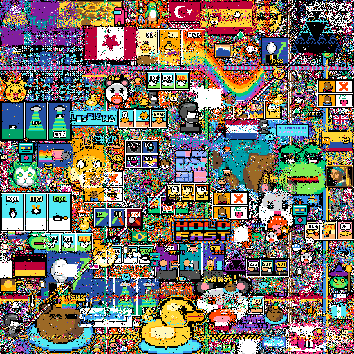

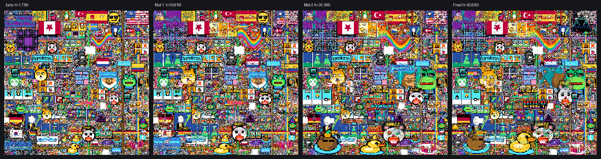

### What Changed
- Initial baseline implementation: `512x512` fixed canvas, `36,000` online citizen slots on PyTorch MPS, trained `RedditCitizenNet` policy, curated pixel art (comics, cartoon memes, flags, rainbows, gold-framed paintings, bold wordmarks), and live local VLM epoch decisions.

### What Worked
- **Dense, authentic `r/place` feel:** All 200 factions landed within the first ~4.5% of ticks, leaving zero empty white void while keeping artworks bold, iconic, and immediately legible.
- **High placement depth (`336.6 px/px`):** Every community had enough budget to finish cleanly, defend borders, weave border hearts (`281` alliances), expand into gaps (`99` expands), and survive Void eruptions (`11` collapses total).

### What Didn't
- Heavily relied on hand-crafted built-in catalogs (`39` cartoon memes, `69` micro-sprites, `21` comics, only `5` diffusion images), so scaling to much larger canvases without new AI art would repeat templates.

---

## 02 — Reddit 2022 8h Scale-Up (`2000x2000`)

**Specs:** `1000x1000 -> 2000x1000 -> 2000x2000` (4-Act + Whiteout) · `32,494` ticks · `204,310,781` placements (`51.1 px/px`) · `631` founded (`214` alive at peak) · `87.1%` non-white (mostly free-agent noise).

  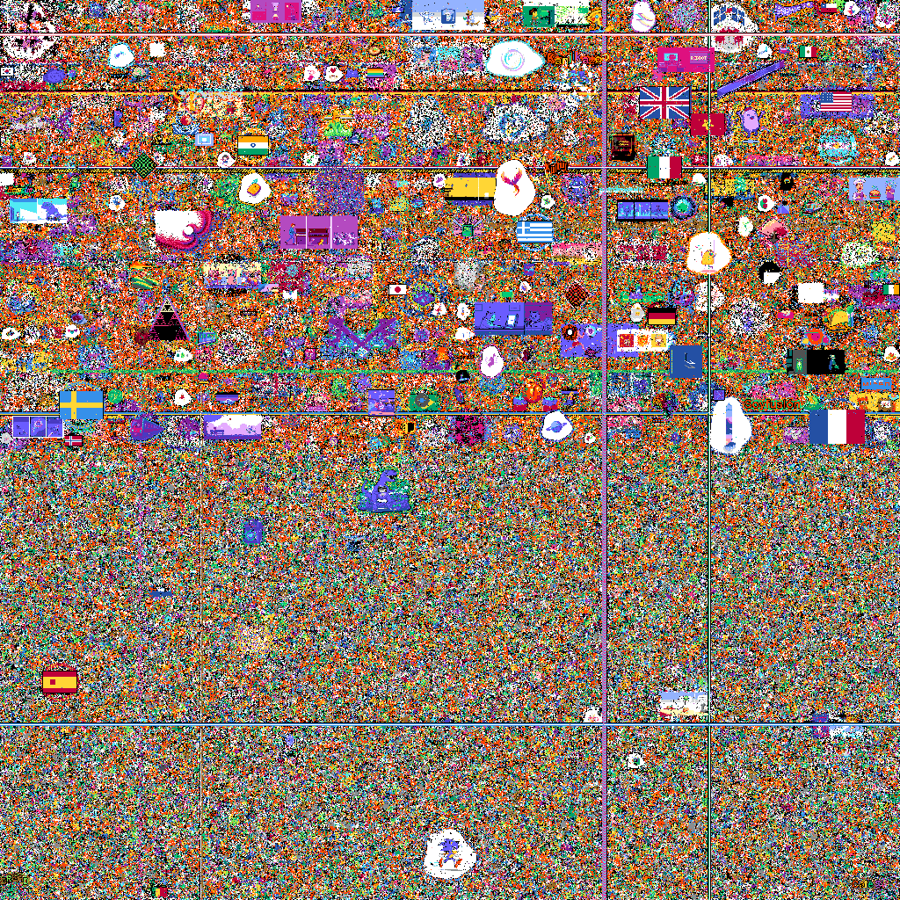

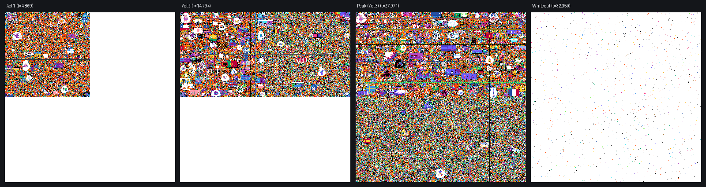

### What Changed
- Scaled up to 1:1 Reddit `r/place` 2022 geometry (`2000x2000` with 4-Act canvas expansions and Whiteout Finale) and switched to AI-first faction creation using `Qwen3-VL-30B-A3B` + local 4-bit MLX `FLUX.1-schnell` Pixel-Art LoRA + sandboxed `ai_code`.

### What Worked
- Proved `204M+` placements at `10,000+ px/s` on Apple Silicon MPS, 4-Act palette unlocks (`16 -> 24 -> 32 -> Whiteout`), and dynamic camera zoom-out playback.
- Individual FLUX artworks and flags looked great up close.

### What Didn't
- **Giant orange TV-static ocean:** `2000x2000` is `15.3x` the area of `512x512`. Running Qwen3-VL + FLUX + MPS concurrently stalled AI spawning, so free agents carpeted empty wings in orange/teal static while `417 / 631` factions burned out.
- **White sticker-bubble ovals:** A safety guard in `diffusion.py` (`> 82%` stripped) aborted background removal on small FLUX sprites, wrapping them in chunky white ovals.

---

## 03 — Async 9:16 4K 8h (`1080x1920`)

**Specs:** `540x960 -> 1080x960 -> 1080x1920` (4-Act + Whiteout) · `46,329` ticks · `125,939,907` placements (`60.7 px/px`) · `4,551` founded (`2,437` alive at peak) · `88.4%` non-white.

  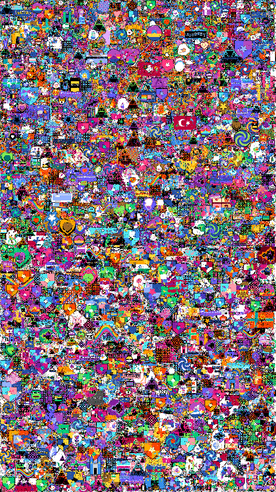

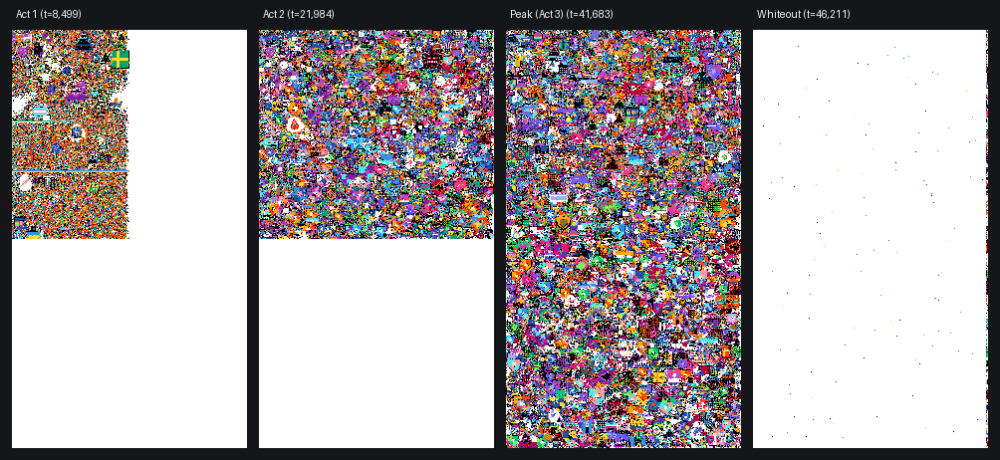

### What Changed
- First attempt at vertical 9:16 YouTube Shorts format (`1080x1920` upscaled `2x` to 4K `2160x3840`) with boosted spawn rates and `Qwen3-VL` structured JSON schemas.

### What Worked
- Vertical 9:16 framing felt right for Shorts, and `2160x3840` @ `60 fps` kept nearest-neighbor pixels sharp on YouTube.

### What Didn't
- **Hardware-vs-quality race:** Wall-clock async execution plus Metal swap thrashing (concurrent Qwen3-VL + varying-size FLUX shapes) stalled FLUX, forcing overflow spawns into `700` identical procedural star-shields, `338` Sierpinski fractals, and `972` repeated micro-sprites.
- **4-Act expansions zoomed out too far** for mobile viewing, and free agents still filled empty background with orange static.

---

## 04 — Deterministic `720x1280` (First Art Bank)

**Specs:** `720x1280` fixed (no expansion, no whiteout) · `6,000` step-locked ticks · `18,522,278` placements (`20.1 px/px`) · `600` founded (`600` alive) · `45.9%` non-white · `6` wars, `8` alliances.

  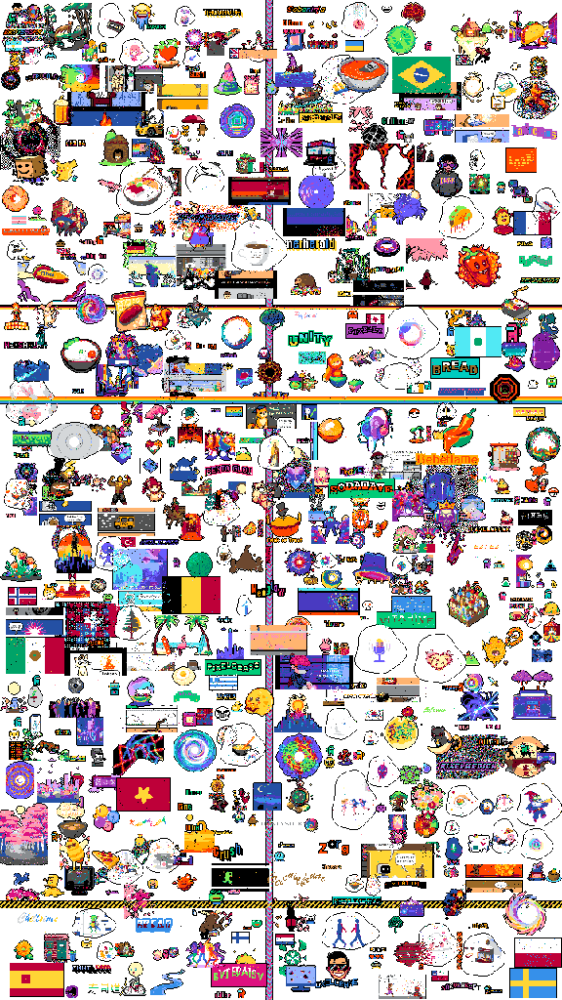

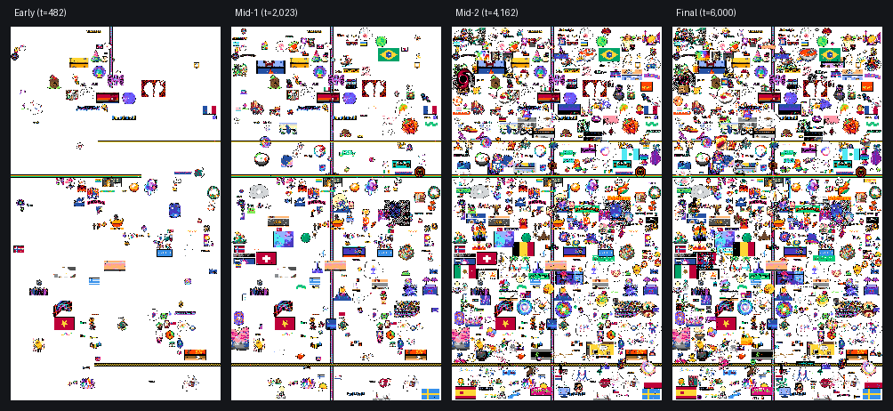

### What Changed
- Introduced **step-locked deterministic mode (`--sync`)**, decoupled 2-stage **`forge-bank`** (Qwen3-VL solo -> unload -> MLX FLUX solo at a single compiled `512x512` shape), `--no-generic-fallbacks`, Day-0 launch wave (`80` factions), and `--targeted-chaos` (zero background noise).

### What Worked
- **Zero Metal swap thrashing** (`~6.3s/image` FLUX steady state), **zero procedural shields**, **zero duplicate templates**, and **zero orange TV static**!

### What Didn't
- **Far too much empty white space (`54.1%` white):** `720x1280` (`921k px`, `3.5x` larger than `512x512`) with `0.85x` sprites and linear spawning across 85% of the run left wide white gaps and almost zero border competition (`6` wars total).
- White sticker-bubble ovals were still baked into the Art Bank.

---

## 05 — Bubble-Stripped `540x960` & Natural Rivals

**Specs:** `540x960` fixed · `6,000` ticks · `16,290,870` placements (`31.4 px/px`) · `540` founded (`520` alive) · `82.3%` non-white · `455` wars (`49` Natural Rivalries), `93` alliances, `19` flash-raids.

  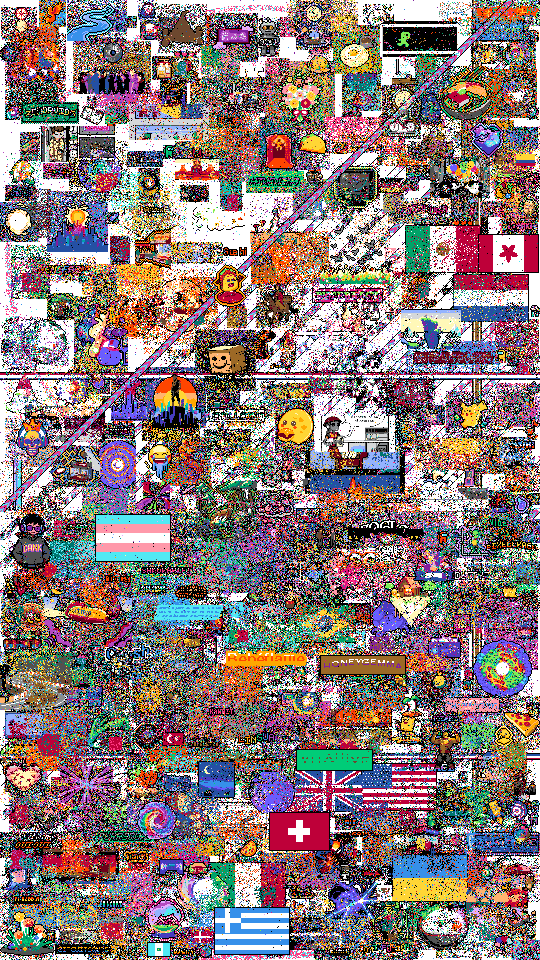

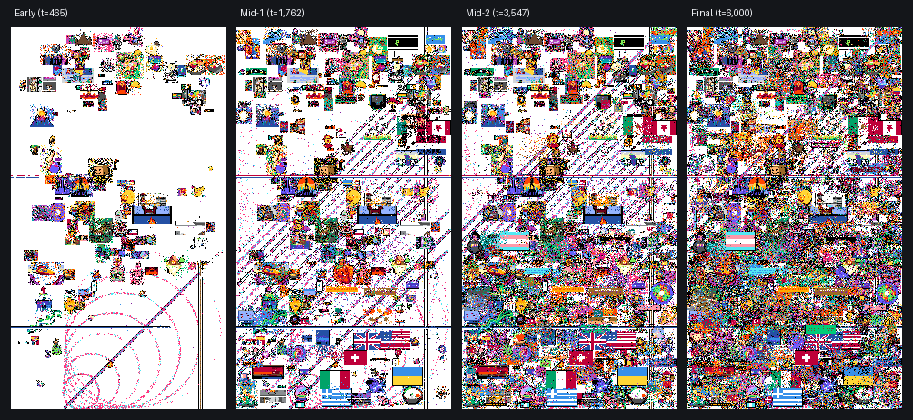

### What Changed
- Shrunk canvas to `540x960` (`4x` -> 4K), added `strip_white_sticker_bubble()` (stripping 71 white ovals in `0.09s`), fixed `diffusion.py`'s `0.82 -> 0.95` guard, added **AI-curated Natural Rival Pairs (`rivals.json`)** + classic rival flags spawning face-to-face, and added autonomous epoch border wars.

### What Worked
- **White sticker bubbles completely gone!**
- **Natural rival matchups visibly popped:** Mexico vs Canada, UK vs USA, Italy vs Greece, Sweden vs Norway, BentoBox vs SushiDive, WafflePancake vs MemePancake all fought face-to-face.
- Coverage jumped from `45.9%` to `82.3%`.

### What Didn't
- **Raid confetti speckle:** Uncapped `455` simultaneous wars spraying random pixels across entire enemy bounding boxes (including transparent corners) turned mid-board war zones into speckled static.
- **Diagonal ribbon ghost stripes & concentric rings:** Stepping a `d2` diagonal ribbon shifted its offset each growth step (painting parallel candy-cane stripes), and an unguarded fallback in `_expand_perimeter` drew giant circular rings around diagonal ribbon bounding boxes.

---

## 06 — `360x640` v1 (`512x512` Area Twin)

**Specs:** `360x640` fixed (`230k px`, `6x` -> 4K) · `12,000` ticks · `36,191,671` placements (`157.1 px/px`) · `340` founded (`159` alive at end) · `84.7%` non-white · `81` wars, `309` alliances, `264` fortifies, `45` expands, `181` collapses.

  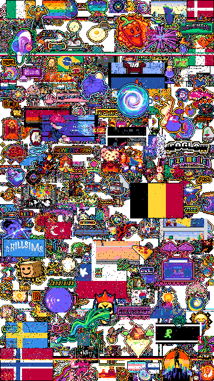

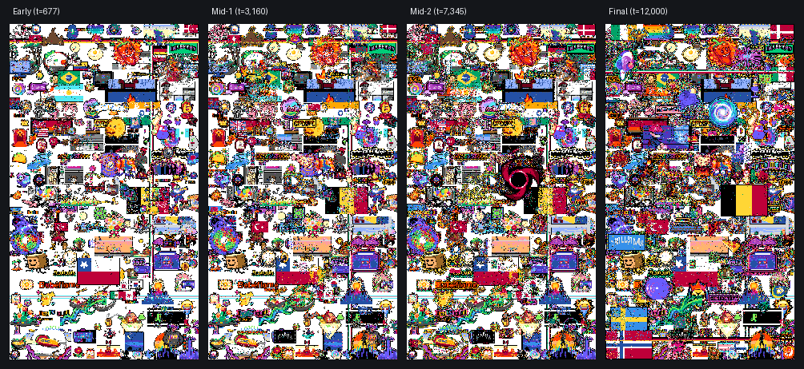

### What Changed
- Matched the original `512x512` (`262k px`) sweet spot in 9:16 with **`360x640` (`230k px`)**, prioritized **all 4 corners and 4 walls flush first**, front-loaded the Hour-1 land grab (`98%` faction coverage by Hour `1.0`), capped concurrent wars (`<= 16`) with coherent opaque-pixel frontline pushes, and restricted ribbons strictly to horizontal/vertical.

### What Worked
- **No diagonal ghosts, no raid confetti, crisp bold readability, and instant Hour-1 full-board land grab** (`99%` coverage by `t=200`).
- Deep placement density (`157 px/px`) brought back clean, sharp pixel art.

### What Didn't
- **Noisy checkerboard `FORTIFY` halos:** `add_silhouette_fortify` fired `264` times, wrapping sprites in 3-pixel alternating checker static.
- **Persistent white cracks:** `--targeted-chaos` banned every player from painting unowned white pixels in the triangular cracks between round cutouts.
- **Excessive late burnout:** `181` collapses outran the `340` total faction cap, dropping active factions from `260` down to `159` by Hour 72.

---

## 07 — `360x640` Niche Boxes (Stopped Mid-Run)

**Specs:** `360x640` fixed · stopped at `6,600` ticks · `29,543,490` placements (`128.2 px/px`) · `285` founded (`285` alive) · `92.3%` non-white · `139` templated `niche_badge` factions.

  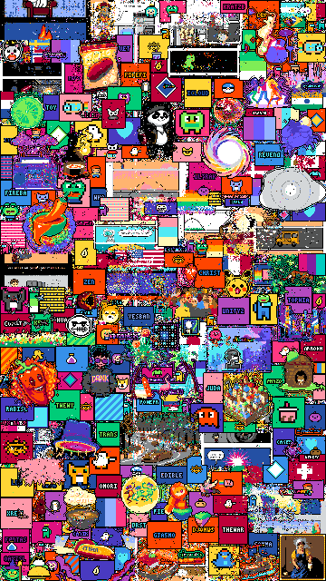

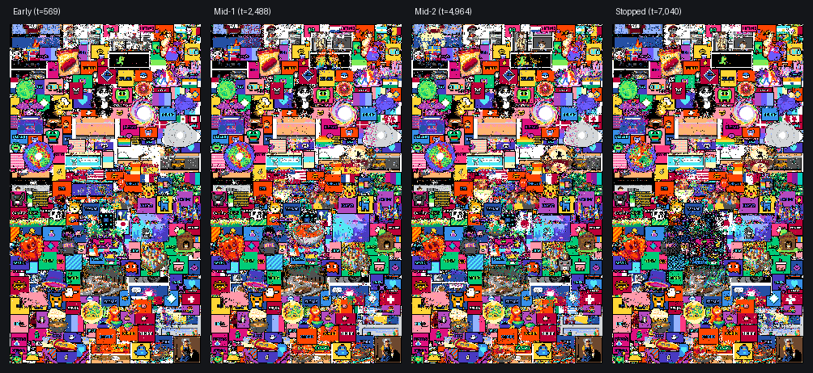

### What Changed
- Built pixel-level whitespace niche hunting (`find_whitespace_niche`), white-claiming free agents, clean 1px solid fortify outlines (replacing checkerboard fuzz), and gentle burnout (`<= 2` collapses/epoch).
- Experimented with procedural small niche badges (`generate_niche_badge`) to seal remaining gaps.

### What Worked
- **Solved empty white background completely (`92.3%` non-white, `100%` coverage)** with zero burnout drop-off and gorgeous landmark pieces (gold-framed *The Milkmaid* anchored flush in the bottom-right corner, large FLUX murals, crisp flags).

### What Didn't
- **Generic Python word-box spam:** Stopped early on visual inspection — `generate_niche_badge` filled the board with dozens of repetitive flat colored boxes containing a single bitmap word (`ZEN`, `OMORI`, `TOY`, `ICLOUD`, etc.) and generic diamond/stripe tiles, breaking the organic human look.

---

## 08 — `360x640` v2 (100% AI Visuals & Zero Word Boxes)

**Specs:** `360x640` fixed (`3x` -> `1080x1920` & `6x` -> `2160x3840`) · `10,000` ticks · `37,011,573` placements (`160.6 px/px`) · `312` founded (`300` alive) · `91.9%` non-white · `71` wars, `267` alliances, `230` clean 1px fortifies, `55` flag expands, `26` flash-raids, `14` Void events, `12` collapses.

  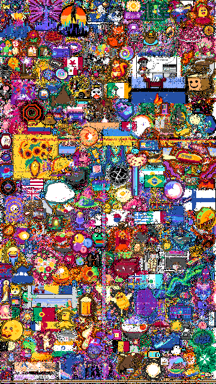

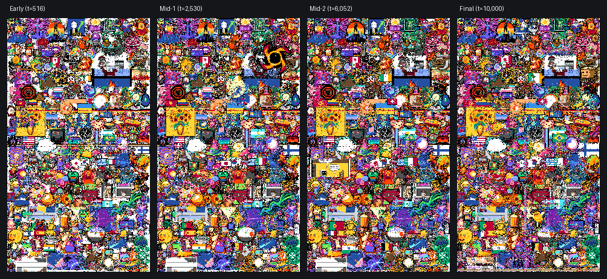

### What Changed
- Enforced **`REQ-ART-018` (zero Python-rendered word boxes, bitmap banners, or templated geometric tiles)** — deleted `generate_niche_badge`, set `ArtBank(visual_only=True)`, and added `ArtBank.pop_best_fit()` so whitespace niche-hunters fit **real, unique AI FLUX artworks** (or `<= 1`-copy pixel sprites) directly into remaining pockets.
- Added permanent `0..31` palette index clamps across `canvas.py`, `neural.py`, and `timelapse.py`.
- Exported both `1080p` (`3x`) and `4K` (`6x`) 60fps Shorts.

### What Worked
- **The magic is back — and upgraded:** Wall-to-wall unique art from the opening seconds (`300` active factions all the way to Hour 72, `91.9%` non-white with remaining ~8% inside flags, fried eggs, clouds, and comic panels), zero generic word boxes, zero shields, zero white bubbles, zero checkerboard halos.
- **Rich live storytelling across all 4 snapshots:** Gold-framed Van Gogh *Sunflowers*, *Stonks*, a swirling Black Hole Void eruption at `t=2,530`, face-to-face rivalries (Japan vs South Korea, Greece vs Italy, USA vs UK, Canada vs Mexico, France vs Spain vs Portugal, Brazil overtaking Argentina), and a neon vertical ribbon slicing up the center seam late in the run.

### What Didn't (Caught & Fixed for Next Art Bank)
- **Bottom-left wrapped comic (`ComicCats` / `PixelPunch`):** Center-cropping a `512x512` 2-row FLUX comic page down to a wide `80x36` (`2.22:1`) strip sliced straight across the middle horizontal gutter, leaving the bottom half of the top panel above the top half of the bottom panel. Fixed permanently in `bank.py` (near-square `62x54`–`84x72` comic sizing) and `flux_art.py` (top-row crop for wide non-cutout frames) for all future Art Banks.
